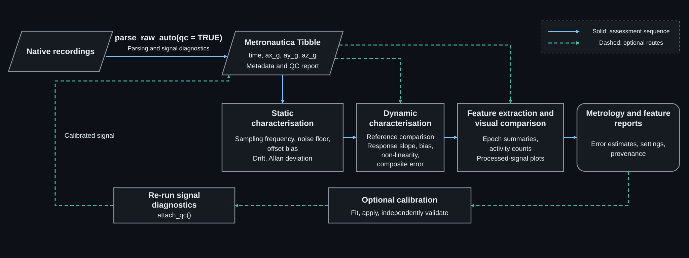

# Metronautica

*Navigate wearable triaxial accelerometer signals into transparent metrology and reports.*

Use wearable accelerometer native recordings, parse into a common data format
with metadata and signal diagnostics attached, and choose your measurement
pathway. This R package will allow you to retain wearable accelerometer data
longitudinally by preserving structure and metadata, while allowing you to use
different published summary features.

This repository is developed for a research article under submission. Analysis
and recording samples are in [WAM](https://github.com/miltheo/wam).

[Getting started](docs/GETTING_STARTED.md) | [Reference PDF](docs/metronautica-reference.pdf) | [Browser guide](https://miltheo.github.io/metronautica/)

## Processing workflow



[Native recordings](#native-recordings "GENEActiv/SENS BIN; Axivity CWA/AX3 CSV; ActiGraph GT3X/LEAP CSV/LEAP AGSD; HBK G-Link CSV.") →
[Metronautica Tibble](#metronautica-tibble "Four required columns: time (POSIXct), ax_g, ay_g, az_g (numeric g). Metadata, diagnostics and reports are optional pipeline additions.") →
[Static](#static-characterisation) → [Dynamic](#dynamic-characterisation) →
[Features](#feature-extraction-and-visual-comparison) → [Reports](#metrology-and-feature-reports).

Stages can run independently; [optional calibration](#optional-calibration) returns
to assessment with refreshed QC. The browser guide provides clickable diagram boxes.

## Function map

| Stage | Entry point | Source |
|---|---|---|
| Parsing | [`parse_raw_auto()`](https://miltheo.github.io/metronautica/reference.html#parse_raw_auto) | [m_parsers.R](R/m_parsers.R) |
| Signal diagnostics | [`qc_accel_tbl()`](https://miltheo.github.io/metronautica/reference.html#qc_accel_tbl) | [m_qc.R](R/m_qc.R) |
| Interval selection | [`clip_bundle()`](https://miltheo.github.io/metronautica/reference.html#clip_bundle) | [m_accel_clipper.R](R/m_accel_clipper.R) |
| Static characterisation | [`static_metrology_from_tbl()`](https://miltheo.github.io/metronautica/reference.html#static_metrology_from_tbl) | [m_static.R](R/m_static.R) |
| Dynamic characterisation | [`dynamic_metrology_report()`](https://miltheo.github.io/metronautica/reference.html#dynamic_metrology_report) | [m_dynamic.R](R/m_dynamic.R) |
| Optional calibration | [`dm_fit_vm_calibration()`](https://miltheo.github.io/metronautica/reference.html#dm_fit_vm_calibration) | [m_dynamic.R](R/m_dynamic.R) |
| Axis filtering | [`filter_accel_tbl()`](https://miltheo.github.io/metronautica/reference.html#filter_accel_tbl) | [m_filter.R](R/m_filter.R) |
| Feature extraction | [`compute_accel_summaries()`](https://miltheo.github.io/metronautica/reference.html#compute_accel_summaries) | [m_accel_summary_suite.R](R/m_accel_summary_suite.R) |
| Activity counts | [`accel_metric_agcounts()`](https://miltheo.github.io/metronautica/reference.html#accel_metric_agcounts) | [m_agcounts.R](R/m_agcounts.R) |
| Visualisation | [`plot_processed_metric()`](https://miltheo.github.io/metronautica/reference.html#plot_processed_metric) | [m_plotter.R](R/m_plotter.R) |
| Sample retrieval | [`m_load_sample_data()`](https://miltheo.github.io/metronautica/reference.html#m_load_sample_data) | [m_sample_data.R](R/m_sample_data.R) |

## Installation

Install dependencies in R:

```r
install.packages(c("tibble", "dplyr", "data.table", "digest", "jsonlite",
                   "signal", "ggplot2", "ggrepel", "scales"))
```

Download the repository, then install its directory:

```r
install.packages("path/to/metronautica", repos = NULL, type = "source")
```

Alternatively, run `R CMD INSTALL .` from the repository root.
[Optional packages](docs/GETTING_STARTED.md#optional-packages) support selected decoders and features.

## Quick start

```r
library(metronautica)
example("getting-started", package = "metronautica")
```

For a native recording:

```r
accel <- parse_raw_auto("path/to/recording.agsd", return = "bundle", qc = TRUE)
accel_meta(accel)$processing$qc
# Defaults: ENMO and MAD.
# Other features: see reference.
features <- compute_accel_summaries(accel, measures = c("ENMO", "MAD"), epoch_s = 5)
head(features$data_wide)
```

[Static and dynamic examples](docs/GETTING_STARTED.md#real-recording-examples)
include plots from WAM's native samples. Other package use requires no WAM downloads.

## Native recordings

`parse_raw_auto()` detects the format and attaches
[`primary-five` signal diagnostics](https://miltheo.github.io/metronautica/reference.html#qc_accel_tbl--details)
at `meta$processing$qc` by default. The reference gives the five rules and their
reported outputs, following Supplementary Table S2 of the research article.

| Device | Supported input |
|---|---|
| ActiGraph LEAP | AGSD, exported CSV |
| ActiGraph wGT3X-BT / GT9X Link | GT3X |
| Axivity AX3 | CWA, exported CSV |
| GENEActiv / SENS motion | BIN |
| HBK G-Link | Exported CSV |

Check [decoder requirements and limits](https://miltheo.github.io/metronautica/reference.html#parse_raw_auto) before parsing.

<a name="acceleration-tibble"></a>

## Metronautica Tibble

[Metronautica Tibble 0.1.0](data-contract/0.1.0/SPECIFICATION.md) defines the
sample-level data contract: one decoded observation per row, with `time`
(`POSIXct`) and `ax_g`, `ay_g`, `az_g` (numeric acceleration in *g*), in that order.
UTC is the storage convention. Metadata, signal diagnostics and assessment
reports are optional pipeline attachments.

`as_accel_tbl()` constructs the tibble; `accel_meta()` reads its metadata.
[Minimal example](examples/tibble_minimal.R) · [Specification index](data-contract/README.md).

## Static characterisation

Select a stationary interval. `static_metrology_from_tbl()` returns signed 1-*g*
VM offset bias, drift rate, static noise floor, Allan deviation and plots.
[Static example](docs/GETTING_STARTED.md#static-characterisation).

## Dynamic characterisation

Specify a reference, excitation schedule and measurement range.
`clip_dynamic_stages()` selects stages; `dynamic_metrology_report()` returns
VM response slope, signed VM bias, VM integral non-linearity, composite error and plots.
[Dynamic example](docs/GETTING_STARTED.md#dynamic-characterisation).

## Feature extraction and visual comparison

`compute_accel_summaries()` returns epoch features and settings; `accel_metric_*()`
functions calculate individual features. Use `plot_accel_clip()` for acceleration,
`plot_processed_metric()` for features and `accel_metric_agcounts()` for activity counts.
[Feature extraction and comparison](docs/GETTING_STARTED.md#feature-extraction).

## Metrology and feature reports

Retain units, reference, tested range and processing settings with the outcomes.
Static reports return `summary`/`meta`; dynamic reports return `stages`/`overall`/`meta`;
feature results return `data_long`/`data_wide`/`settings`.
[Outcome definitions](https://miltheo.github.io/metronautica/reference.html#measurement-definitions).

Static and dynamic report functions default to `attach_report = TRUE`.
Capture `result$data` to retain compact assessments in
`accel_meta(result$data)$processing$reports`; `attach_report = FALSE` opts out.
Records retain results, assessed selections, settings, diagnostics and provenance;
plots remain separate. Keep the unfiltered samples to support later metric
calculations when their input requirements are met.
[Native-recording retention example](examples/data_contract.R).

## Optional calibration

Fit and apply a VM mapping only when warranted. Independently validate its benefit,
refresh diagnostics with `attach_qc()` and repeat the selected assessments.
[Calibration workflow and example](docs/GETTING_STARTED.md#optional-calibration).

## Help and citation

Use `help("function_name", package = "metronautica")` for parameters and methods.
[Documentation builds](docs/README.md) and [activity-count validation](docs/ACTIGRAPH_COUNTS.md)
cover maintenance and benchmarks.

[Citation](CITATION.cff) | **GPL-3** ([licence](LICENSE.md), [dependency notices](docs/DEPENDENCY_LICENSING.md)).
Sample provenance and licensing are maintained in WAM.

Maintainer: [Millen James Theophilus](https://github.com/miltheo),
[ORCID](https://orcid.org/0000-0001-9823-7177).
[Report issues](https://github.com/miltheo/metronautica/issues) with the call,
error, `sessionInfo()` and a reproducible input where permitted.
