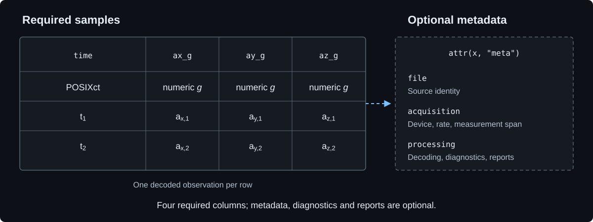

# Metronautica Tibble

The named sample-level data contract used by Metronautica. Its only required
fields are `time` (`POSIXct`) and `ax_g`, `ay_g`, `az_g` (numeric acceleration in
*g*), in that order. Metadata, diagnostics, reports and bundle wrappers are
optional implementations of the Metronautica pipeline.

## Structure

<!-- GUIDE:tibble:start -->

Symbolic rows show the structure; metadata, diagnostics and reports are optional.
<!-- GUIDE:tibble:end -->

| Version | Specification | Formats |
|---|---|---|
| **0.1.0** | [Full specification](0.1.0/SPECIFICATION.md) | [PDF](0.1.0/Metronautica_Tibble_0.1.0.pdf), [Word](0.1.0/Metronautica_Tibble_0.1.0.docx) |

The specification separates core requirements from optional pipeline fields and
includes diagnostic definitions and the attached-report structure. Conformance
alone does not establish signal quality or satisfy every analysis's input
requirements.

- [Minimal example without metadata](../examples/tibble_minimal.R)
- [Study example retaining static and dynamic assessments](../examples/data_contract.R)
- [Brief installed-help and reference summary](../man/common-data-format.Rd)
- [Browser specification](../docs/metronautica-tibble.html)

`0.1.0/SPECIFICATION.md` is the maintained repository specification. The Word/PDF
files are generated with `tools/build_tibble_spec.ps1`.
The brief R-help topic deliberately avoids repeating the field catalogue.
