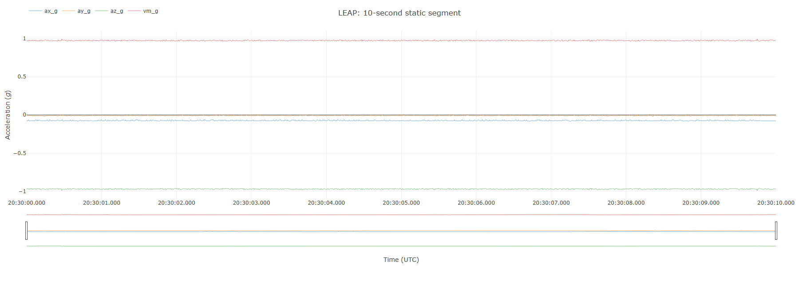
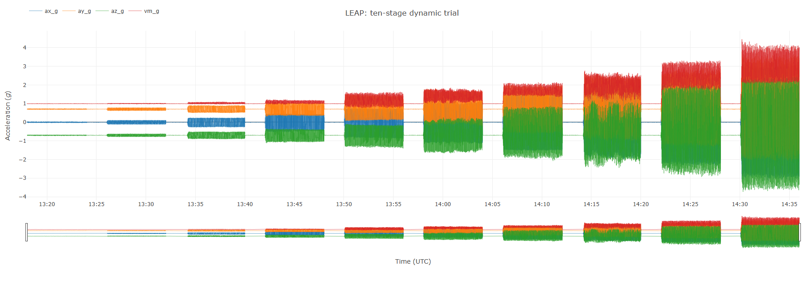
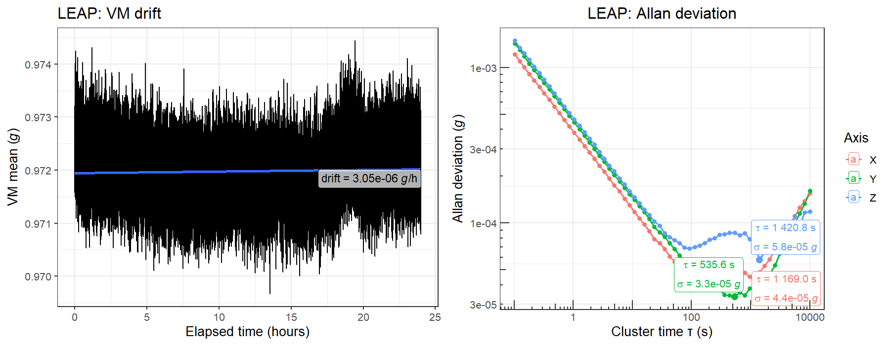
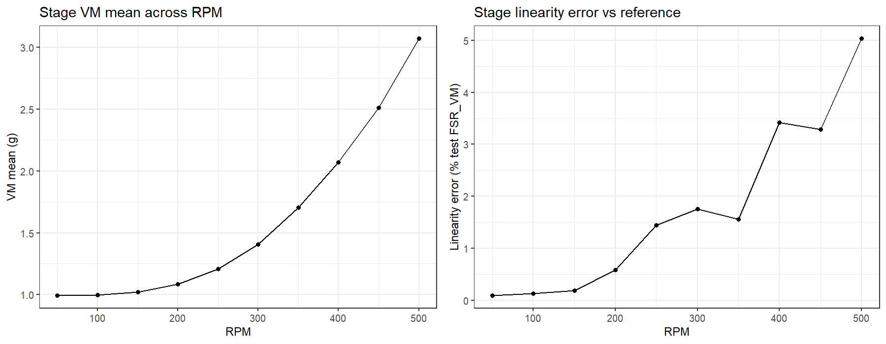
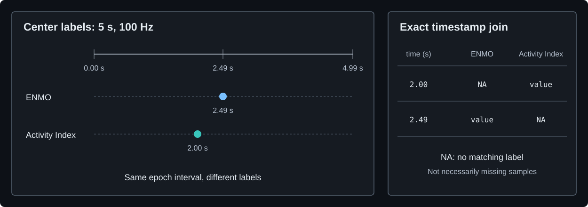
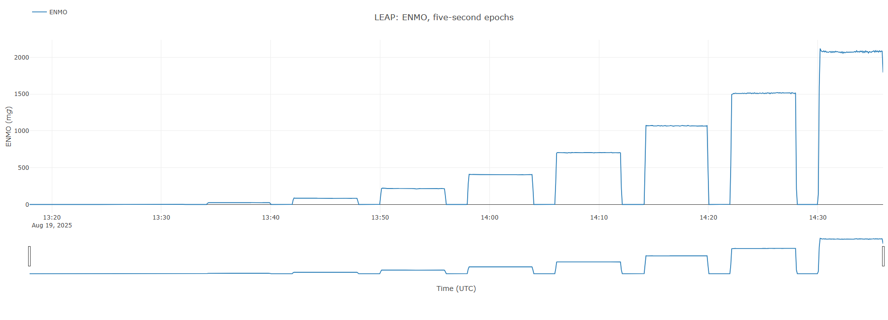
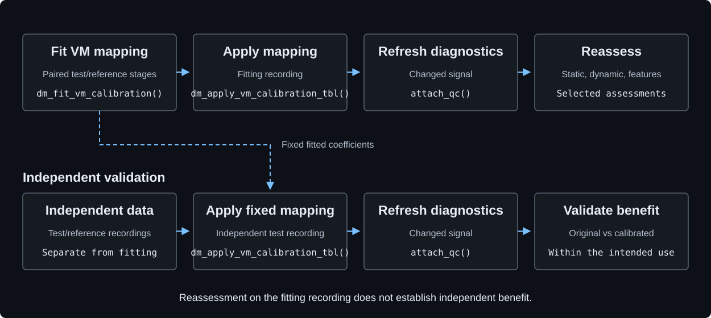

# Getting started

Follow the [installation instructions](../README.md#installation). Signal plots
require `plotly`: install it with `install.packages("plotly")`.

[Recording and trace](#your-own-recording) →
[Diagnostics](#inspect-data-and-diagnostics) →
[Static](#static-characterisation) → [Dynamic](#dynamic-characterisation) →
[Features](#feature-extraction) → [Reports](#metrology-and-feature-reports).
Stages can run independently; [optional calibration](#optional-calibration)
returns to diagnostics and reassessment.

## Your own recording

```r
library(metronautica)
accel <- parse_raw_auto("path/to/recording.agsd", qc = TRUE)
plot_accel_clip(accel, include_vm = TRUE, title = "Recorded acceleration")
```

Use any [supported native format](../README.md#native-recordings). Inspect the
axes and vector magnitude (VM) before selecting an assessment interval.
The plot supports zoom, hover values and a time-range slider.

## Real recording examples

These examples use the LEAP static recording and ten-stage dynamic trial from
[WAM](https://github.com/miltheo/wam/blob/main/samples/README.md). Clone or download
WAM, then select its included `samples/` directory:

```r
options(metronautica.sample_dir = "path/to/wam/samples")
```

The loader restores verified recordings under `metronautica-samples/`.
Both LEAP samples have a 16-*g* full-scale span (±8 *g*).
The [loader reference](reference.html#m_load_sample_data) covers LEAP, AX3, SENS
and GENEActiv samples, remote configuration, checksums and overwrite handling.
No download URL is set by default. Dynamic retrieval includes the HBK reference
unless `include_reference = FALSE`.

### Static trace

<!-- EXAMPLE:static_trace:start -->
```r
path <- m_load_sample_data("LEAP", "static")
stationary <- parse_raw_auto(path, full_scale_range_g = 16)
segment <- clip_bundle(stationary, start_time = attr(path, "sample_info")$analysis_start_utc, duration_s = 10)
plot_accel_clip(segment, include_vm = TRUE, title = "LEAP: 10-second static segment")
```
<!-- EXAMPLE:static_trace:end -->



### Dynamic trace

<!-- EXAMPLE:dynamic_trace:start -->
```r
path <- m_load_sample_data("LEAP", "dynamic", include_reference = FALSE)
motion <- parse_raw_auto(path, full_scale_range_g = 16)
plot_accel_clip(motion, include_vm = TRUE, title = "LEAP: ten-stage dynamic trial")
```
<!-- EXAMPLE:dynamic_trace:end -->



These previews show the output of `plot_accel_clip()`; plots are interactive in
R. Long traces are thinned for display only. The retained signal is unchanged.

<a name="metronautica-tibble"></a>

## Inspect data and diagnostics

Parsing returns a [Metronautica Tibble 0.1.0](../data-contract/0.1.0/SPECIFICATION.md):
`time` (`POSIXct`, UTC) and `ax_g`, `ay_g`, `az_g` (acceleration in *g*), in that
order. [Structure diagram](../data-contract/README.md#structure). VM is calculated for plotting; it is not an additional required column.

<!-- EXAMPLE:diagnostics:start -->
```r
head(motion, 3)
qc <- accel_meta(motion)$processing$qc
qc[c("n_samples", "median_dt_ms", "near_limit_pct")]
```
<!-- EXAMPLE:diagnostics:end -->

<!-- OUTPUT:trace:start -->
First three parsed observations (display rounded to six decimals):

| `time` (UTC) | `ax_g` | `ay_g` | `az_g` |
|---|---:|---:|---:|
| 2025-08-19 13:17:58.000 | -0.000520 | 0.698169 | -0.703868 |
| 2025-08-19 13:17:58.007 | -0.000618 | 0.694247 | -0.703865 |
| 2025-08-19 13:17:58.015 | -0.000318 | 0.706009 | -0.699785 |

Selected diagnostics for this recording:

| Field | Value |
|---|---:|
| `n_samples` | 599,552 |
| `median_dt_ms` | 7.8125 |
| `near_limit_pct` | 0.0000 |
<!-- OUTPUT:trace:end -->

These example values describe the complete dynamic recording. Parsing attaches
[`primary-five` diagnostics](reference.html#qc_accel_tbl--details) by default.
`as_accel_tbl()` does not; use `attach_qc()` to attach them to decoded tables.
Near-limit diagnostics require a known measurement range. Diagnostics describe
integrity and timing; they do not repair samples or establish measurement accuracy.
`clip_bundle()` removes inherited diagnostics; use `qc_accel_tbl(segment)` to
assess the selected static segment.

Choose either characterisation pathway below, or proceed directly to
[feature extraction](#feature-extraction). The example
settings describe these recordings; select intervals and schedules for your own
experiment. The static assessment uses 24 hours; the dynamic assessment uses
all ten stages and a separately parsed HBK reference.

## Static characterisation

<!-- EXAMPLE:static:start -->
```r
library(metronautica)

# Retrieve native recording ----
path <- m_load_sample_data(device = "LEAP", type = "static")
info <- attr(path, "sample_info")
stationary <- parse_raw_auto(
    path, return = "bundle", time_shift_s = info$time_shift_s,
    full_scale_range_g = info$full_scale_range_g)
static_result <- static_metrology_from_tbl(
    stationary, start_utc = info$analysis_start_utc,
    duration_h = 24, progress = FALSE)
static_result$summary
static_result$drift_plot
static_result$allan_plot
# Retain the assessed recording ----
stationary <- static_result$data
accel_meta(stationary)$processing$reports$static[[1]]$results$summary

```
<!-- EXAMPLE:static:end -->



Left: one-second VM means and fitted drift. Right: axis-specific Allan deviation.
No additional filtering or dynamic VM calibration is applied. Stationarity must
be established separately, including continuity within the selected interval.
Full static recordings can take several minutes and substantial memory to parse.

## Dynamic characterisation

Specify the reference, excitation schedule, trims and configured measurement
span. Filter or clip **before** constructing stages: these operations change
`full`, leaving existing `stages` unchanged; calibration processes both.
[Container contracts](reference.html#common-data-format--input-and-return-contracts).

<!-- EXAMPLE:dynamic:start -->
```r
library(metronautica)

# Retrieve native recording ----
path <- m_load_sample_data(device = "LEAP", type = "dynamic")
info <- attr(path, "sample_info")
ref_info <- attr(path, "reference_info")

# Parse test and reference signals ----
test <- parse_raw_auto(
    path, return = "bundle", time_shift_s = info$time_shift_s,
    full_scale_range_g = info$full_scale_range_g)
reference <- parse_raw_auto(
    attr(path, "reference_file"), return = "bundle",
    time_shift_s = ref_info$time_shift_s,
    full_scale_range_g = ref_info$full_scale_range_g)

# Specify identical excitation schedules ----
test_stages <- clip_dynamic_stages(
    test, start_utc = info$trial_start_utc,
    n_stages = 10L, stage_min = 6, buffer_min = 2,
    rpm_start = 50, rpm_step = 50, trim_start_min = 1, trim_end_min = 1)
ref_stages <- clip_dynamic_stages(
    reference, start_utc = ref_info$trial_start_utc,
    n_stages = 10L, stage_min = 6, buffer_min = 2,
    rpm_start = 50, rpm_step = 50, trim_start_min = 1, trim_end_min = 1)

# Compare retained dynamic stages ----
dynamic_result <- dynamic_metrology_report(
    test_stages, ref_stages, test_axis_fsr_g = info$full_scale_range_g,
    ref_axis_fsr_g = ref_info$full_scale_range_g,
    compute_entropy = FALSE, inspect_alignment = FALSE,
    add_plot = TRUE, progress = FALSE)
dynamic_result$stages
dynamic_result$overall
dynamic_result$plots$vm_mean_vs_rpm
dynamic_result$plots$linearity_vs_rpm
# Retain the assessed trial ----
test_stages <- dynamic_result$test_clips
retained <- dynamic_result$data

# Save samples and assessments ----
saveRDS(retained, "dynamic_trial.rds")
retained <- readRDS("dynamic_trial.rds")

```
<!-- EXAMPLE:dynamic:end -->



Each six-minute stage loses one minute at each end. Plots show stage-mean VM
and reference-based VM integral non-linearity without additional filtering or
calibration. Catalogue shifts are applied separately to test and reference;
index-based pairing does not correct timestamps or infer clock-rate correction.
The supplied HBK reference requires +3600 s; use each file's own catalogue shift
and span. Observed extrema do not establish measurement limits.

## Feature extraction

Continue with `motion` from the dynamic trace above; characterisation is not a
prerequisite. Summarise the same native signal into five-second epochs:

<!-- EXAMPLE:features:start -->
```r
features <- compute_accel_summaries(
    motion, measures = c("ENMO", "SVMGMEAN", "SVMBP_069_10", "MAD"),
    epoch_s = 5, epoch_anchor = "start", quiet = TRUE)
head(features$data_wide)
features$settings$metric_units
```
<!-- EXAMPLE:features:end -->

These four pipelines are examples, not the full feature set.
`data_wide` contains epoch summaries; `data_long` retains each feature's labels.
Keep `settings` with the values to retain units and processing choices.
[Available features and definitions](reference.html#compute_accel_summaries).

Features can label epochs differently: exact timestamp joins may create extra
rows and unpaired `NA` cells, which need not indicate missing acceleration.
Do not zero-fill them. See [epoch conventions](reference.html#compute_accel_summaries--epoch-timestamps-and-joins)
and the [worked timestamp example](../examples/offline_workflow.R).



Synthetic 100-Hz example with center labels: ENMO uses 2.49 s; Activity Index uses
2.00 s from its one-second bin labels. Labels do not change calculated values.
Compare epoch intervals before combining features.

For other pipelines, consult the [feature-settings example](../examples/feature_settings.R)
and the relevant reference: [Activity Index noise variance](reference.html#accel_metric_ai),
[MIMS measurement span](reference.html#accel_metric_mims),
[band-pass settings](reference.html#accel_metric_svmbp) or
[standalone activity counts](reference.html#accel_metric_agcounts).

### Visualise a processed feature

<!-- EXAMPLE:processed_trace:start -->
```r
plot_processed_metric(features, "ENMO", title = "LEAP: ENMO, five-second epochs")
```
<!-- EXAMPLE:processed_trace:end -->



`plot_processed_metric()` uses the result's recorded units and provides zoom,
hover values and a time-range slider. This preview shows ENMO in m*g*.

### Compare feature pipelines

The same trial is shown below for ENMO, mean gravity-subtracted SVM, band-pass
SVM (0.69–10 Hz) and MAD. Comparable ranges share a panel; MAD has its own scale.


All values remain in m*g*. Shading marks excitation stages, with adjustment
periods retained. Only band-pass SVM applies its specified axis filter; no
additional VM calibration is applied. No prefiltering, resampling or amplitude
normalisation is requested. Feature differences within one recording
do not establish device equivalence or behavioural validity.
[Full comparison and plotting recipe](../examples/feature_comparison.R).

## Metrology and feature reports

Inspect static `summary`, dynamic `stages`/`overall` and feature
`data_long`/`data_wide`/`settings`. Retain the reference, assessed range, signal
state, timing assumptions, units and resolved settings with the outcomes.
Within-stage variability differs from trial-to-trial repeatability; error
estimates are not a complete uncertainty budget.
[Outcome definitions](reference.html#measurement-definitions).

Static and dynamic reports attach assessments by default. Capture `result$data`;
plots remain separate. Above, `stationary` retains the static recording and
`retained` the complete dynamic trial; metrology uses its trimmed stages.
`saveRDS()` preserves samples, timestamps, metadata and assessments.
[Full retention example](../examples/data_contract.R).

## Optional calibration



Fit and apply a reference-based VM mapping only when warranted. This rescales
vector magnitude while preserving direction; it does not calibrate axes
independently. Continuing with the matched stages above:

```r
fit <- dm_fit_vm_calibration(test_stages, ref_stages)
calibrated <- dm_apply_vm_calibration_tbl(retained, fit$summary)
calibrated <- attach_qc(calibrated)
```

Calibration removes inherited diagnostics; `attach_qc()` recomputes them.
Independently validate the benefit, then repeat the relevant characterisation
and feature assessments. Fitting and reassessing the same trial is not
independent validation. See the [calibration method](reference.html#dm_fit_vm_calibration)
and [runnable synthetic example](../examples/calibration.R).

## Optional packages

| Operation | Requirement or supported scope |
|---|---|
| LEAP AGSD | Built-in: LEAP v2, dataVersion 3, firmware 2.1.0.106, 128 Hz, calibrationMethod 2 |
| Modern GT3X native-precision decoding | `read.gt3x` 1.2.0; other layouts/settings require explicit legacy mode |
| GENEActiv BIN | `GENEAread` |
| Unsupported fast AX3 CWA layouts | `GGIRread` fallback |
| Interactive plots | `plotly` |
| MIMS-unit | `MIMSunit` |
| Dynamic entropy diagnostics | `TSEntropies` |

Install only the required packages; functions do not install dependencies.
[Parser reference](reference.html#parse_raw_auto) defines decoder settings and limits.

## Next steps

Use the [minimal four-column example](../examples/tibble_minimal.R) to construct
a Metronautica Tibble from decoded data.

<a name="offline-example"></a>

A [synthetic example](../examples/offline_workflow.R) runs without recording downloads.
