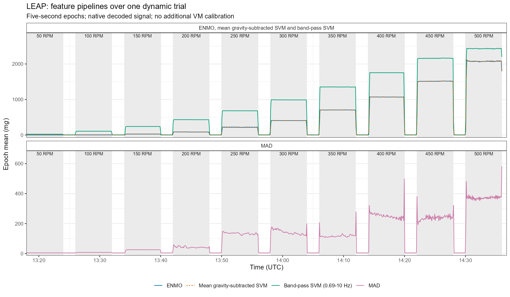

# Recording and processing guide

[Getting started](GETTING_STARTED.md) &middot; [Function reference](reference.html) &middot; [PDF](metronautica-reference.pdf)

Worked code and plot previews are in [Getting Started](GETTING_STARTED.md#real-recording-examples).
This guide covers sample retrieval and processing choices.

## Sample retrieval

The [WAM sample guide](https://github.com/miltheo/wam/blob/main/samples/README.md)
is the canonical source for recording contents, distribution, provenance and
licensing. Obtain the selected attachments and catalogue there before use.

`m_load_sample_data()` accepts `device = "LEAP"`, `"AX3"`, `"SENS"` or `"GENEActiv"`
and `type = "static"` or `"dynamic"`. Configure the local sample directory:

```r
options(metronautica.sample_dir = "path/to/wam/samples")
path <- m_load_sample_data(device = "LEAP", type = "dynamic")
```

For remote retrieval, explicitly set `metronautica.sample_base_url` to the
published release-attachment directory. No URL is configured by default.

Dynamic retrieval includes the HBK reference unless `include_reference = FALSE`.
The returned path carries `sample_info`, `reference_file` and `reference_info`
attributes. Use each file's own time shift and measurement span when parsing.
The reference requires its documented +3600-second shift; do not apply the
wearable's shift to it. No clock-rate correction is inferred.

Compressed and restored SHA-256 checksums are verified. Identical local outputs
are reused; different existing files are protected unless `overwrite = TRUE`.
The default destination is `metronautica-samples/`; each recording has a JSON
provenance sidecar. [Loader parameters](reference.html#m_load_sample_data).

## Assessment intervals

Static assessment requires an explicit start and duration. Incomplete boundary
coverage warns; that check does not establish stationarity or internal continuity.
Full static parsing can require several minutes and substantial memory.

Dynamic assessment requires the full stage schedule and both trims. Apply any
intended filtering before constructing stage bundles. Filtering or generic clipping
of a stage bundle modifies `full`, leaving its existing `stages` unchanged.
[Container contracts](reference.html#implementation-guide).

A test-axis peak-to-peak measurement span is required for normalised dynamic
errors: 16 *g* means -8 to +8 *g*. Observed signal extrema do not establish this span.
Review time alignment independently of sample-index matching.
[Dynamic methods](reference.html#dynamic_metrology_report).

## Feature settings

Epoch duration, rate, axis filtering, calibration state and aggregation define a
feature pipeline. Retain `settings` with the results. Use the direct
`accel_metric_*()` functions for individual calculations.

| Feature or operation | Required decision |
|---|---|
| Activity Index | Supply stationary per-axis noise variance (`ai_noise_var`, *g*²), estimated with `compute_ai_noise_var_from_static()`; noise-floor SD is a different quantity |
| MIMS | Supply the configured measurement span; default passband is 0.2-5 Hz; request alternatives explicitly |
| Band-pass SVM | Specify cutoffs; invalid Nyquist limits error by default; explicit clipping and applied cutoffs are recorded |
| Activity counts | Use `accel_metric_agcounts()`; `AG` is not a summary selector; custom filters require separate interpretation |
| Processed-signal plotting | `plot_processed_metric()` reads units from summary settings; bare tables require an explicit unit label |

Sample-level features, Activity Index and MIMS can label epochs differently.
`data_wide` joins exact timestamps; additional rows and unpaired cells do not
necessarily indicate missing acceleration. Inspect intervals before joining or
comparing features, and do not replace unpaired values with zero.
[Feature parameters](reference.html#compute_accel_summaries).

## Feature comparison

Apply feature pipelines to the same recording before comparing their outputs.
The example below overlays ENMO, mean gravity-subtracted SVM and band-pass SVM
where their ranges are comparable; MAD occupies a second scale in the same figure.
All values remain in m*g* with no amplitude normalisation. Coincident ENMO/SVM
curves are shown using solid/dashed lines. These are different calculations,
not interchangeable definitions.

<!-- EXAMPLE:comparison:start -->
```r
library(metronautica)
library(ggplot2)

path <- m_load_sample_data(device = "LEAP", type = "dynamic",
    include_reference = FALSE)
info <- attr(path, "sample_info")
recording <- parse_raw_auto(path, return = "bundle",
    time_shift_s = info$time_shift_s,
    full_scale_range_g = info$full_scale_range_g)
comparison <- compute_accel_summaries(recording,
    measures = c("ENMO", "SVMGMEAN", "SVMBP_069_10", "MAD"),
    epoch_s = 5, epoch_anchor = "start", quiet = TRUE)
comparison$settings$metric_units

plot_data <- comparison$data_long
main_panel <- "ENMO, mean gravity-subtracted SVM and band-pass SVM"
plot_data$panel <- factor(ifelse(plot_data$measure == "MAD",
    "MAD", main_panel), levels = c(main_panel, "MAD"))
start <- as.POSIXct(info$trial_start_utc, tz = "UTC")
stages <- data.frame(start = start + (0:9) * 8 * 60,
    end = start + (0:9) * 8 * 60 + 6 * 60, rpm = seq(50, 500, 50))
comparison_plot <- ggplot(plot_data, aes(time, value, colour = measure, linetype = measure)) +
    geom_rect(data = stages, aes(xmin = start, xmax = end,
        ymin = -Inf, ymax = Inf), inherit.aes = FALSE,
        fill = "grey92", colour = NA) +
    geom_line(linewidth = 0.5) +
    geom_text(data = stages, aes(x = start + 3 * 60, y = Inf,
        label = paste(rpm, "RPM")), inherit.aes = FALSE,
        vjust = 1.4, size = 2.7) +
    facet_wrap(~panel, ncol = 1, scales = "free_y") +
    scale_colour_manual(values = c(ENMO = "#0072B2", SVMGMEAN = "#D55E00",
        SVMBP_069_10 = "#009E73", MAD = "#CC79A7"),
        breaks = c("ENMO", "SVMGMEAN", "SVMBP_069_10", "MAD"),
        labels = c("ENMO", "Mean gravity-subtracted SVM",
            "Band-pass SVM (0.69-10 Hz)", "MAD")) +
    guides(colour = guide_legend(override.aes = list(
        linetype = c("solid", "22", "solid", "solid")))) +
    scale_linetype_manual(values = c(ENMO = "solid", SVMGMEAN = "22",
        SVMBP_069_10 = "solid", MAD = "solid"), guide = "none") +
    scale_x_datetime(date_labels = "%H:%M", date_breaks = "10 min",
        timezone = "UTC", expand = expansion(mult = c(0, 0.01))) +
    scale_y_continuous(expand = expansion(mult = c(0.03, 0.18))) +
    labs(x = "Time (UTC)", y = expression("Epoch mean (m"*italic(g)*")"),
        colour = NULL,
        title = "LEAP: feature pipelines over one dynamic trial",
        subtitle = paste("Five-second epochs; native decoded signal;",
            "no additional VM calibration")) +
    theme_bw(base_size = 11) +
    theme(legend.position = "bottom", strip.text.y = element_text(angle = 0),
        strip.background = element_rect(fill = "white"))
comparison_plot
```
<!-- EXAMPLE:comparison:end -->



Shading marks six-minute excitation stages; unshaded intervals retain the
adjustments. The five-second summaries use start-labelled epochs. The named
band-pass SVM selector applies its own 0.69–10 Hz filter; the other requested
features do not receive that filter. No additional VM calibration is applied.

Use `data_long` to retain feature labels and timestamps, and keep `settings`
with the values. A shared unit does not establish equivalent features. This
within-recording illustration does not test device equivalence or behavioural
validity. [Function details](reference.html#feature-comparison).

## Calibration

`dm_fit_vm_calibration()` fits linear/quadratic VM mappings in the specified
regression direction. Apply only test-to-reference coefficients using the
application helpers. The scalar mapping preserves vector direction; it is not
an axis-specific calibration. Application invalidates inherited QC. Re-run
`attach_qc()` and assess benefit on an independent recording before retaining
the calibration. [Calibration methods](reference.html#dm_fit_vm_calibration).

## Results and reporting

Static results return summaries, one-second means, Allan curves and plots;
dynamic results return stage/pooled outcomes and plots; feature results return
long/wide tables and settings. Keep the reference, interval, measurement range,
signal state, timing assumptions, units and settings with the results.

Within-stage epoch-mean VM variability is distinct from repeated-trial
repeatability. Error estimates are not a complete uncertainty budget. WAM
provides cohort-level analyses and equivalence tests.
[Canonical definitions](reference.html#measurement-definitions).
